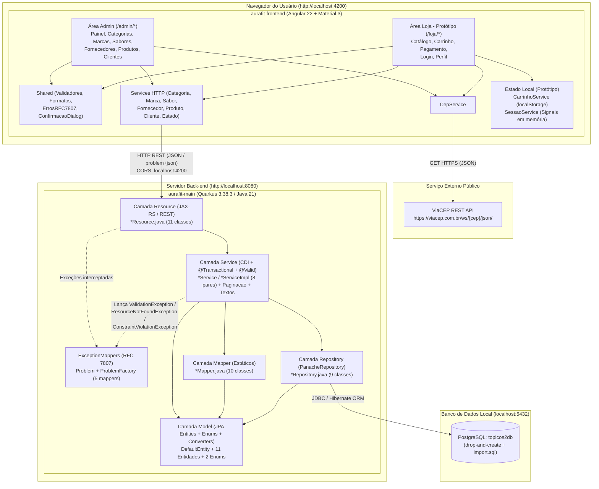

# 02 — Arquitetura e Estrutura do Sistema

Este documento descreve como o projeto **AuraFit** está organizado de fato, as camadas e responsabilidades do back-end e do front-end, direção de dependências, convenções adotadas, todos os pontos de entrada REST e rotas de UI, e onde responsabilidades vazam entre camadas.

---

## 1. Visão Geral e Diagrama de Arquitetura

O sistema segue uma arquitetura **Cliente-Servidor em duas camadas físicas separadas** (SPA Angular 22 + API RESTful Quarkus 3.38.3 sobre PostgreSQL), acrescida de uma integração HTTP direta do navegador com a API pública do **ViaCEP**.

---

## 2. Organização e Camadas do Back-end (`aurafit-main`)

Pacote raiz: `br.unitins.topicos1.aurafit`

| Pacote | Responsabilidade Real | Direção de Dependências |
|---|---|---|
| `resource` | Exposição de endpoints HTTP JAX-RS (`@Path`, `@GET`, `@POST`, `@PUT`, `@DELETE`), leitura de `@PathParam`/`@QueryParam` com `@DefaultValue` e retorno de DTOs ou `Response`. Não contém lógica de negócio. | Depende apenas de `service`, `dto`, `model` (apenas nos 2 resources de enum) e `exception` (nos 2 resources de enum). |
| `service` | Coração das regras de negócio, demarcação transacional (`@Transactional`), validação Bean Validation na assinatura das interfaces (`@NotNull @Valid`), normalização de strings (`Textos`), validação de paginação (`Paginacao`), montagem de entidades e invocação de `Mapper` e `Repository`. | Depende de `repository`, `model`, `dto`, `mapper` e `exception`. **Nota:** `MunicipioService.buscarOuCriar` retorna a entidade JPA `Municipio` para ser consumida internamente por `ClienteServiceImpl`. |
| `mapper` | Classes utilitárias `final` com métodos estáticos `toResponse(Entidade)` (e `TelefoneMapper.toModel(TelefoneRequestDTO)`). | Depende apenas de `model` e `dto` (e outros `mapper`). |
| `repository` | Classes `@ApplicationScoped` implementando `PanacheRepository<Entidade>`, encapsulando consultas HQL/Panache (`findByNome`, `findBy...ExceptId`, `buscar`, `existeCom...`) e ordenação padrão (`order by nome` / `razaoSocial`). | Depende apenas de `model` e Panache/JPA. |
| `model` | Entidades JPA (`@Entity` estendendo `DefaultEntity`), enums (`TipoProteina`, `Regiao`) com `@JsonFormat(shape = OBJECT)` e converters JPA (`@Converter(autoApply = true)`). | Depende apenas de Jakarta Persistence e Jackson (`@JsonFormat` nos enums). |
| `dto` | Records imutáveis de entrada (`*RequestDTO` com anotações Jakarta/Hibernate Validator) e saída (`*ResponseDTO` + `PageResponse<T>`). | Depende de Jakarta/Hibernate Validator e dos enums `TipoProteina`/`Regiao`. |
| `exception` | Hierarquia de exceções (`ValidationException`, `ResourceNotFoundException`), modelo RFC 7807 (`Problem`, `ProblemFactory`) e 5 `@Provider ExceptionMapper`. | Independente das regras de negócio; atua transversalmente no pipeline JAX-RS. |

---

## 3. Organização e Camadas do Front-end (`aurafit-frontend`)

Diretório raiz de código: `src/app/`

| Camada / Pasta | Responsabilidade Real | Observações Arquiteturais |
|---|---|---|
| `models/` | Interfaces TypeScript espelhando os Request/Response DTOs do back-end, `Pagina<T>`, `ProblemaApi` e `EnderecoViaCep`. | Contratos puros (apenas `type`/`interface`, sem lógica em runtime). |
| `services/` | Clientes HTTP (`CategoriaService`, `MarcaService`, `SaborService`, `FornecedorService`, `ProdutoService`, `ClienteService`, `EstadoService`), cliente externo (`CepService`) e serviços de estado local do protótipo (`CarrinhoService`, `SessaoService`). | Usam `inject(HttpClient)` e a constante `API_URL` (`http://localhost:8080`). |
| `shared/` | Validadores customizados (`Validadores`), formatadores/máscaras (`formatos.ts`, `FormatoPipe`), tradutor de erros RFC 7807 para Reactive Forms (`erros-formulario.ts`), modal de confirmação (`ConfirmacaoDialog`), wrapper de snackbar (`NotificacaoService`) e tradução do paginador (`PaginadorPtBr`). | Excelente centralização: evita duplicação de regex de CPF/CNPJ/CEP e de parsing de erros da API nos componentes. |
| `components/admin/` | Layout administrativo (`AdminLayout`), dashboard (`Painel`) e 6 módulos CRUD (`categorias`, `marcas`, `sabores`, `fornecedores`, `produtos`, `clientes`), cada um dividido em `*-list` e `*-form`. | Todos os componentes são `standalone`, utilizam Angular Signals (`signal()`) para estado reativo de UI e `ReactiveFormsModule` nos formulários. |
| `components/loja/` | Protótipo de e-commerce (`LojaLayout`, `Catalogo`, `Carrinho`, `Pagamento`, `Login`, `Perfil`). | Apenas `Catalogo` consome a API Quarkus (`ProdutoService`, `CategoriaService`) e `Pagamento` consome o ViaCEP (`CepService`). O restante opera em memória/`localStorage`. |

---

## 4. Convenções Reais Descobertas no Código

1. **Idioma do Código:**
   - **Misto (Português + Inglês)** nas assinaturas dos Services e Repositories: métodos padrão CRUD usam inglês (`findAll`, `findById`, `findByNome`, `create`, `update`, `delete`), enquanto métodos específicos de domínio e auxiliares usam português (`buscar`, `buscarOuCriar`, `existeComCategoria`, `validarDados`, `aplicarDados`, `buscarMarcaOuFalhar`).
   - Nos Resources REST, os nomes dos métodos Java são 100% em português (`buscarTodos`, `buscarPorNome`, `buscarPorId`, `incluir`, `alterar`, `apagar`).
   - No Front-end Angular, código, variáveis, sinais e métodos estão 100% em português (`listar`, `buscarPorId`, `incluir`, `alterar`, `excluir`, `carregando`, `salvando`).
2. **Injeção de Dependências:**
   - No Back-end: injeção por campo package-private com `@Inject` (sem `private` e sem construtor), deliberadamente escolhida para permitir que os testes unitários no mesmo pacote (`br.unitins.topicos1.aurafit.service`) injetem dublês em memória diretamente (`service.categoriaRepository = ...`).
   - No Front-end: função `inject(...)` em propriedades `private` da classe.
3. **Padrão de Paginação:**
   - Base 0 (`page = 0`), `pageSize = 10` por padrão nos endpoints REST (exceto `GET /estados` que usa `pageSize = 30`, `ProdutoList` no front que usa `pageSize = 5`, e `Catalogo` na loja que usa `pageSize = 8`).
   - Limite máximo global impuesto por [`Paginacao.java`](file:///c:/Users/AVIS%2001/Documents/Raphael/AuraFit-main/AuraFit-main/aurafit-main/src/main/java/br/unitins/topicos1/aurafit/service/Paginacao.java#L7): `TAMANHO_MAXIMO = 100`.
4. **Padrão de Tratamento de Erros (RFC 7807):**
   - Toda falha esperada ou inesperada retorna `Content-Type: application/problem+json` estruturado por [`ProblemFactory.java`](file:///c:/Users/AVIS%2001/Documents/Raphael/AuraFit-main/AuraFit-main/aurafit-main/src/main/java/br/unitins/topicos1/aurafit/exception/ProblemFactory.java#L14-L29).
   - Erros de campo (sejam de `@Valid` via `ConstraintViolationExceptionMapper` ou de regra de negócio via `ValidationExceptionMapper`) preenchem `errors: [{ field, message }]` com o caminho exato do controle no formulário Angular (ex.: `"endereco.uf"`, `"telefones.0.numero"`).

---

## 5. Mapa Completo de Pontos de Entrada

### 5.1. Endpoints REST do Back-end (42 rotas distribuídas em 11 Resources)

| Resource | Método e Rota | Parâmetros | Retorno (Status) |
|---|---|---|---|
| [`RootResource`](file:///c:/Users/AVIS%2001/Documents/Raphael/AuraFit-main/AuraFit-main/aurafit-main/src/main/java/br/unitins/topicos1/aurafit/resource/RootResource.java) | `GET /` | — | `303 See Other -> /q/swagger-ui` (em `DEV`) ou `200 text/plain` |
| [`CategoriaResource`](file:///c:/Users/AVIS%2001/Documents/Raphael/AuraFit-main/AuraFit-main/aurafit-main/src/main/java/br/unitins/topicos1/aurafit/resource/CategoriaResource.java) | `GET /categorias` `GET /categorias/nome/{nome}` `GET /categorias/{id}` `POST /categorias` `PUT /categorias/{id}` `DELETE /categorias/{id}` | `?page=0&pageSize=10` `{nome}`, `?page=0&pageSize=10` `{id}` Body: `CategoriaRequestDTO` `{id}`, Body: `CategoriaRequestDTO` `{id}` | `200 PageResponse<CategoriaResponseDTO>` `200 PageResponse<CategoriaResponseDTO>` `200 CategoriaResponseDTO` (ou `404`) `201 CategoriaResponseDTO` (ou `400`) `200 CategoriaResponseDTO` (ou `400`/`404`) `204 No Content` (ou `400`/`404`) |
| [`MarcaResource`](file:///c:/Users/AVIS%2001/Documents/Raphael/AuraFit-main/AuraFit-main/aurafit-main/src/main/java/br/unitins/topicos1/aurafit/resource/MarcaResource.java) | `GET /marcas` `GET /marcas/nome/{nome}` `GET /marcas/{id}` `POST /marcas` `PUT /marcas/{id}` `DELETE /marcas/{id}` | `?page=0&pageSize=10` `{nome}`, `?page=0&pageSize=10` `{id}` Body: `MarcaRequestDTO` `{id}`, Body: `MarcaRequestDTO` `{id}` | `200 PageResponse<MarcaResponseDTO>` `200 PageResponse<MarcaResponseDTO>` `200 MarcaResponseDTO` `201 MarcaResponseDTO` `200 MarcaResponseDTO` `204 No Content` |
| [`FornecedorResource`](file:///c:/Users/AVIS%2001/Documents/Raphael/AuraFit-main/AuraFit-main/aurafit-main/src/main/java/br/unitins/topicos1/aurafit/resource/FornecedorResource.java) | `GET /fornecedores` `GET /fornecedores/nome/{nome}` `GET /fornecedores/{id}` `POST /fornecedores` `PUT /fornecedores/{id}` `DELETE /fornecedores/{id}` | `?page=0&pageSize=10` `{nome}`, `?page=0&pageSize=10` `{id}` Body: `FornecedorRequestDTO` `{id}`, Body: `FornecedorRequestDTO` `{id}` | `200 PageResponse<FornecedorResponseDTO>` `200 PageResponse<FornecedorResponseDTO>` `200 FornecedorResponseDTO` `201 FornecedorResponseDTO` `200 FornecedorResponseDTO` `204 No Content` |
| [`SaborResource`](file:///c:/Users/AVIS%2001/Documents/Raphael/AuraFit-main/AuraFit-main/aurafit-main/src/main/java/br/unitins/topicos1/aurafit/resource/SaborResource.java) | `GET /sabores` `GET /sabores/nome/{nome}` `GET /sabores/{id}` `POST /sabores` `PUT /sabores/{id}` `DELETE /sabores/{id}` | `?page=0&pageSize=10` `{nome}`, `?page=0&pageSize=10` `{id}` Body: `SaborRequestDTO` `{id}`, Body: `SaborRequestDTO` `{id}` | `200 PageResponse<SaborResponseDTO>` `200 PageResponse<SaborResponseDTO>` `200 SaborResponseDTO` `201 SaborResponseDTO` `200 SaborResponseDTO` `204 No Content` |
| [`ProdutoResource`](file:///c:/Users/AVIS%2001/Documents/Raphael/AuraFit-main/AuraFit-main/aurafit-main/src/main/java/br/unitins/topicos1/aurafit/resource/ProdutoResource.java) | `GET /produtos` `GET /produtos/nome/{nome}` `GET /produtos/{id}` `POST /produtos` `PUT /produtos/{id}` `DELETE /produtos/{id}` | `?nome=&idTipoProteina=&idCategoria=&idMarca=&page=0&pageSize=10` `{nome}`, `?page=0&pageSize=10` `{id}` Body: `ProdutoRequestDTO` `{id}`, Body: `ProdutoRequestDTO` `{id}` | `200 PageResponse<ProdutoResponseDTO>` `200 PageResponse<ProdutoResponseDTO>` `200 ProdutoResponseDTO` `201 ProdutoResponseDTO` `200 ProdutoResponseDTO` `204 No Content` |
| [`ClienteResource`](file:///c:/Users/AVIS%2001/Documents/Raphael/AuraFit-main/AuraFit-main/aurafit-main/src/main/java/br/unitins/topicos1/aurafit/resource/ClienteResource.java) | `GET /clientes` `GET /clientes/nome/{nome}` `GET /clientes/{id}` `GET /clientes/cpf/{cpf}` `POST /clientes` `PUT /clientes/{id}` `DELETE /clientes/{id}` | `?page=0&pageSize=10` `{nome}`, `?page=0&pageSize=10` `{id}` `{cpf}` Body: `ClienteRequestDTO` `{id}`, Body: `ClienteRequestDTO` `{id}` | `200 PageResponse<ClienteResponseDTO>` `200 PageResponse<ClienteResponseDTO>` `200 ClienteResponseDTO` `200 ClienteResponseDTO` `201 ClienteResponseDTO` `200 ClienteResponseDTO` `204 No Content` |
| [`EstadoResource`](file:///c:/Users/AVIS%2001/Documents/Raphael/AuraFit-main/AuraFit-main/aurafit-main/src/main/java/br/unitins/topicos1/aurafit/resource/EstadoResource.java) | `GET /estados` `GET /estados/nome/{nome}` `GET /estados/{id}` `GET /estados/sigla/{sigla}` | `?page=0&pageSize=30` `{nome}`, `?page=0&pageSize=10` `{id}` `{sigla}` | `200 PageResponse<EstadoResponseDTO>` `200 PageResponse<EstadoResponseDTO>` `200 EstadoResponseDTO` `200 EstadoResponseDTO` |
| [`MunicipioResource`](file:///c:/Users/AVIS%2001/Documents/Raphael/AuraFit-main/AuraFit-main/aurafit-main/src/main/java/br/unitins/topicos1/aurafit/resource/MunicipioResource.java) | `GET /municipios` `GET /municipios/nome/{nome}` `GET /municipios/{id}` | `?page=0&pageSize=10` `{nome}`, `?page=0&pageSize=10` `{id}` | `200 PageResponse<MunicipioResponseDTO>` `200 PageResponse<MunicipioResponseDTO>` `200 MunicipioResponseDTO` |
| [`TipoProteinaResource`](file:///c:/Users/AVIS%2001/Documents/Raphael/AuraFit-main/AuraFit-main/aurafit-main/src/main/java/br/unitins/topicos1/aurafit/resource/TipoProteinaResource.java) | `GET /tipos-proteina` `GET /tipos-proteina/{id}` | — `{id}` | `200 TipoProteina[]` `200 TipoProteina` (ou `404`) |
| [`RegiaoResource`](file:///c:/Users/AVIS%2001/Documents/Raphael/AuraFit-main/AuraFit-main/aurafit-main/src/main/java/br/unitins/topicos1/aurafit/resource/RegiaoResource.java) | `GET /regioes` `GET /regioes/{id}` | — `{id}` | `200 Regiao[]` `200 Regiao` (ou `404`) |

---

## 6. Vazamentos de Responsabilidade e Acoplamentos Relevantes

1. **Serialização JSON acoplada diretamente aos Enums de Domínio (`model`)**:
   - [`TipoProteina.java`](file:///c:/Users/AVIS%2001/Documents/Raphael/AuraFit-main/AuraFit-main/aurafit-main/src/main/java/br/unitins/topicos1/aurafit/model/TipoProteina.java#L7) e [`Regiao.java`](file:///c:/Users/AVIS%2001/Documents/Raphael/AuraFit-main/AuraFit-main/aurafit-main/src/main/java/br/unitins/topicos1/aurafit/model/Regiao.java#L7) usam `@JsonFormat(shape = JsonFormat.Shape.OBJECT)` do Jackson na camada `model` e são retornados diretamente por `TipoProteinaResource`, `RegiaoResource`, `ProdutoResponseDTO` e `EstadoResponseDTO` sem passar por um DTO dedicado.
2. **Lógica de busca/resolução de `TipoProteina` e `Regiao` direto nos Resources de Enum**:
   - Enquanto todas as entidades possuem um `*Service`, [`TipoProteinaResource`](file:///c:/Users/AVIS%2001/Documents/Raphael/AuraFit-main/AuraFit-main/aurafit-main/src/main/java/br/unitins/topicos1/aurafit/resource/TipoProteinaResource.java#L22-L28) e [`RegiaoResource`](file:///c:/Users/AVIS%2001/Documents/Raphael/AuraFit-main/AuraFit-main/aurafit-main/src/main/java/br/unitins/topicos1/aurafit/resource/RegiaoResource.java#L22-L28) executam `valueOf(id)` e lançam `ResourceNotFoundException` diretamente na camada `resource`.
3. **Regra de disponibilidade de vitrine e cálculo de frete/pedido na camada de apresentação (Front-end)**:
   - O back-end não filtra produtos inativos para a vitrine da loja; a regra `disponivel(produto) = produto.ativo && produto.estoque > 0` vive exclusivamente no componente [`Catalogo`](file:///c:/Users/AVIS%2001/Documents/Raphael/AuraFit-main/AuraFit-main/aurafit-frontend/src/app/components/loja/catalogo/catalogo.ts#L106-L108).
   - As regras de frete (`VALOR_FRETE = 19.9`, `FRETE_GRATIS_A_PARTIR = 199`) e limite de quantidade por estoque (`Math.min(quantidade, Math.max(estoque, 1))`) vivem exclusivamente em [`CarrinhoService`](file:///c:/Users/AVIS%2001/Documents/Raphael/AuraFit-main/AuraFit-main/aurafit-frontend/src/app/services/carrinho.service.ts#L10-L44) no navegador.
4. **Resolução de CEP dividida entre Front-end e Back-end**:
   - O front-end ([`CepService`](file:///c:/Users/AVIS%2001/Documents/Raphael/AuraFit-main/AuraFit-main/aurafit-frontend/src/app/services/cep.service.ts)) consulta a API externa do ViaCEP e repassa `cidade`, `uf` e `codigoIbge` no payload de `ClienteRequestDTO`. O back-end confia nos valores de `cidade`, `uf` e `codigoIbge` enviados pelo cliente HTTP para criar automaticamente um novo registro na tabela `municipio` ([`MunicipioServiceImpl.buscarOuCriar`](file:///c:/Users/AVIS%2001/Documents/Raphael/AuraFit-main/AuraFit-main/aurafit-main/src/main/java/br/unitins/topicos1/aurafit/service/MunicipioServiceImpl.java#L48-L78)), sem validar no servidor junto ao ViaCEP ou base oficial do IBGE se aquele município realmente existe.
