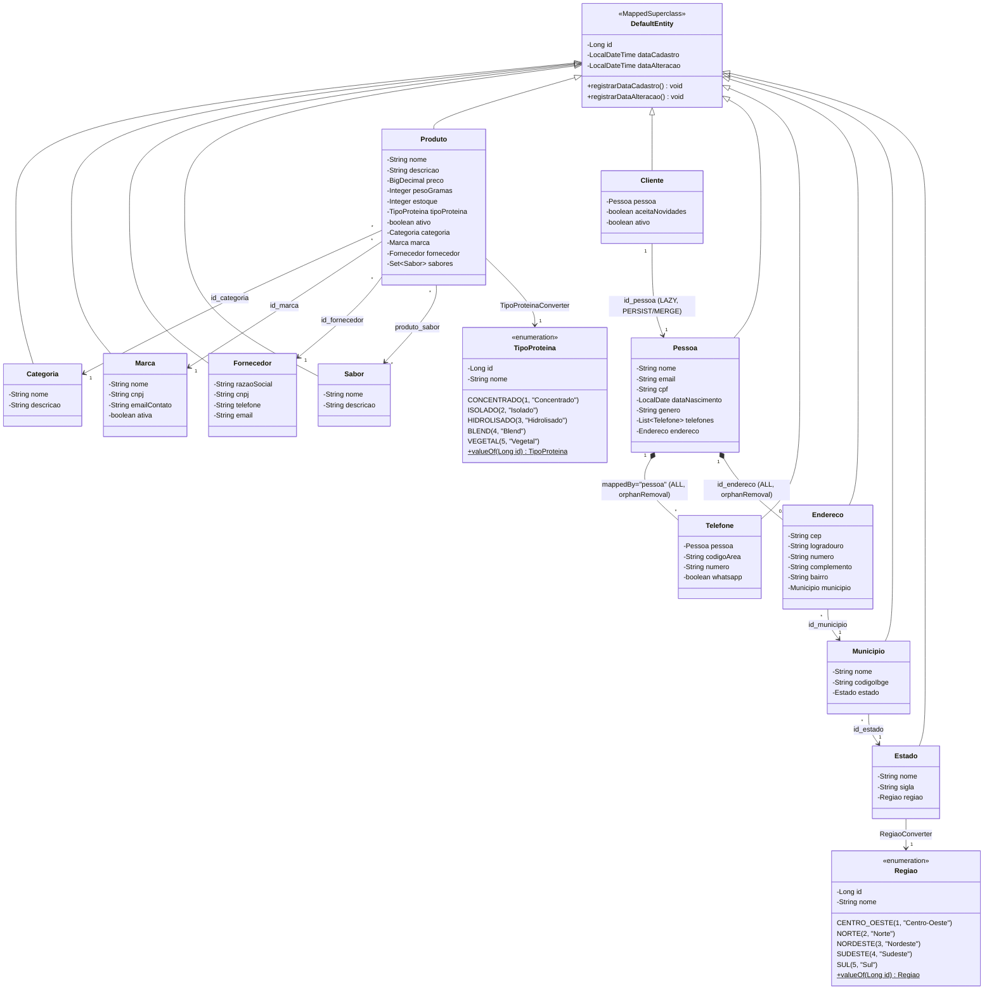
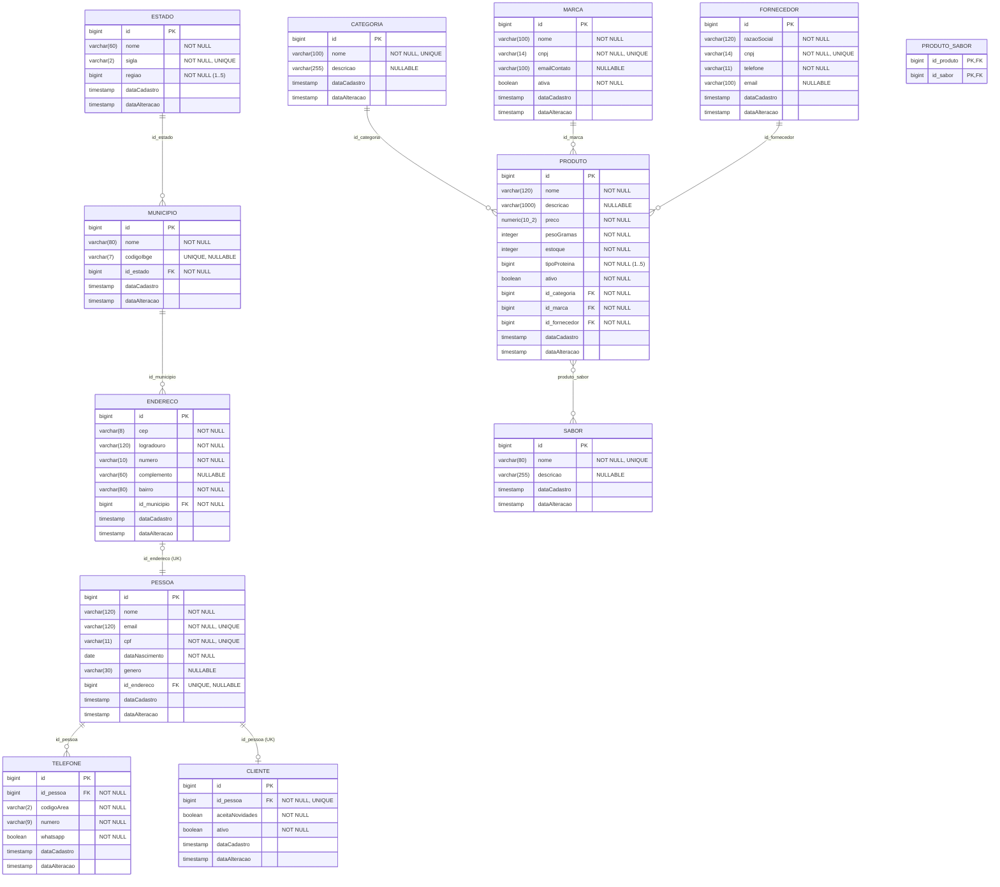
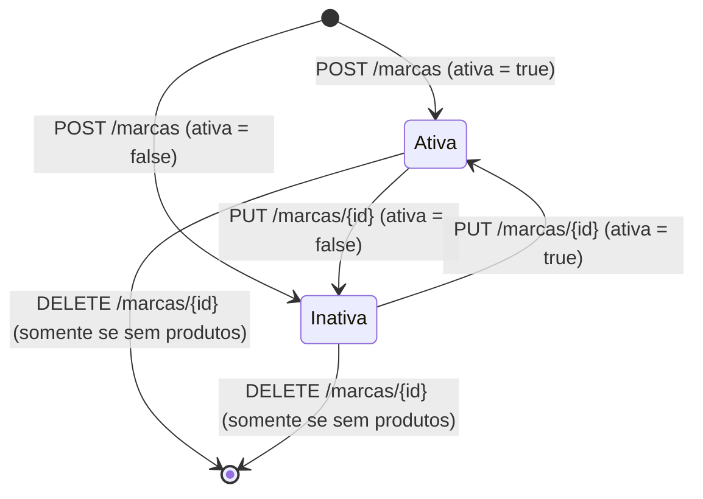
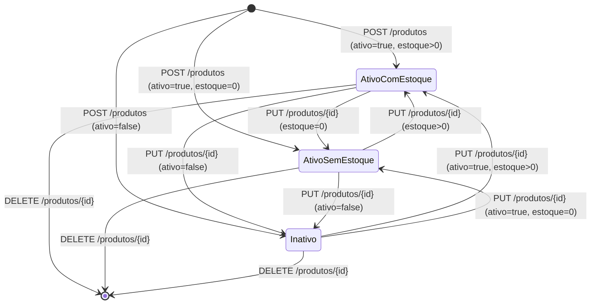

# 03 — Domínio e Modelo de Dados

Este documento descreve o vocabulário do domínio, as entidades e seus relacionamentos, os diagramas de classes e ER extraídos diretamente do código-fonte e do script de carga inicial, as máquinas de estado e as divergências encontradas entre código, documentação (`diagrama-classes.puml`) e banco de dados (`import.sql`).

---

## 1. Vocabulário do Domínio (Glossário)

| Termo no Código | Onde Vive | Significado Real no Sistema |
|---|---|---|
| **DefaultEntity** | [`DefaultEntity.java`](file:///c:/Users/AVIS%2001/Documents/Raphael/AuraFit-main/AuraFit-main/aurafit-main/src/main/java/br/unitins/topicos1/aurafit/model/DefaultEntity.java#L12-L56) | Superclasse JPA (`@MappedSuperclass`) compartilhada por todas as 11 entidades persistentes. Fornece `id` (`IDENTITY`), `dataCadastro` (preenchida via `@PrePersist`) e `dataAlteracao` (preenchida via `@PreUpdate`). |
| **Produto** | [`Produto.java`](file:///c:/Users/AVIS%2001/Documents/Raphael/AuraFit-main/AuraFit-main/aurafit-main/src/main/java/br/unitins/topicos1/aurafit/model/Produto.java#L14-L147) | Item comercializado na loja de suplementos (ex.: Whey Protein, Barra de Proteína). Possui preço (`BigDecimal`), peso em gramas, estoque (`Integer`), classificação obrigatória de `TipoProteina`, flag `ativo`, vínculos obrigatórios com `Categoria`, `Marca` e `Fornecedor`, e conjunto opcional (`0..*`) de `Sabor`. |
| **TipoProteina** | [`TipoProteina.java`](file:///c:/Users/AVIS%2001/Documents/Raphael/AuraFit-main/AuraFit-main/aurafit-main/src/main/java/br/unitins/topicos1/aurafit/model/TipoProteina.java#L7-L42) | Enumeração de domínio que classifica a proteína do suplemento: `CONCENTRADO` (1), `ISOLADO` (2), `HIDROLISADO` (3), `BLEND` (4), `VEGETAL` (5). Persistida no banco pelo `id` numérico (`BIGINT`) via [`TipoProteinaConverter`](file:///c:/Users/AVIS%2001/Documents/Raphael/AuraFit-main/AuraFit-main/aurafit-main/src/main/java/br/unitins/topicos1/aurafit/model/converterjpa/TipoProteinaConverter.java#L7-L19) e serializada em JSON como objeto `{ id, nome }` (`@JsonFormat(shape = OBJECT)`). |
| **Categoria** | [`Categoria.java`](file:///c:/Users/AVIS%2001/Documents/Raphael/AuraFit-main/AuraFit-main/aurafit-main/src/main/java/br/unitins/topicos1/aurafit/model/Categoria.java#L6-L30) | Agrupamento mercadológico de produtos (ex.: "Whey Protein", "Creatina", "Pré-Treino"). Possui `nome` único e `descricao` opcional. |
| **Marca** | [`Marca.java`](file:///c:/Users/AVIS%2001/Documents/Raphael/AuraFit-main/AuraFit-main/aurafit-main/src/main/java/br/unitins/topicos1/aurafit/model/Marca.java#L6-L53) | Fabricante/detentora da marca do suplemento (ex.: "Growth Supplements", "Max Titanium"). Possui `nome`, `cnpj` único (14 dígitos sem máscara), `emailContato` opcional e flag `ativa` (permite inativar sem excluir). |
| **Fornecedor** | [`Fornecedor.java`](file:///c:/Users/AVIS%2001/Documents/Raphael/AuraFit-main/AuraFit-main/aurafit-main/src/main/java/br/unitins/topicos1/aurafit/model/Fornecedor.java#L6-L54) | Pessoa jurídica distribuidora/atacadista que fornece o produto à loja. Possui `razaoSocial`, `cnpj` único (14 dígitos), `telefone` (10 ou 11 dígitos como string única) e `email` opcional. |
| **Sabor** | [`Sabor.java`](file:///c:/Users/AVIS%2001/Documents/Raphael/AuraFit-main/AuraFit-main/aurafit-main/src/main/java/br/unitins/topicos1/aurafit/model/Sabor.java#L6-L30) | Variação sensorial disponível para um produto (ex.: "Chocolate", "Baunilha", "Natural"). Associado a `Produto` em relação N:N (`produto_sabor`), sem controle de estoque individual por sabor. |
| **Pessoa** | [`Pessoa.java`](file:///c:/Users/AVIS%2001/Documents/Raphael/AuraFit-main/AuraFit-main/aurafit-main/src/main/java/br/unitins/topicos1/aurafit/model/Pessoa.java#L19-L106) | Entidade base de pessoa física contendo `nome`, `email` único, `cpf` único (11 dígitos), `dataNascimento`, `genero` opcional, lista de `Telefone` (`1..*` na validação de entrada) e `Endereco` (`1:1`). Projetada para ser reutilizada por composição (`@OneToOne`) por `Cliente` e futuramente `Funcionario`/`Usuario`. |
| **Cliente** | [`Cliente.java`](file:///c:/Users/AVIS%2001/Documents/Raphael/AuraFit-main/AuraFit-main/aurafit-main/src/main/java/br/unitins/topicos1/aurafit/model/Cliente.java#L10-L47) | Papel de consumidor da loja vinculado a uma `Pessoa` por composição (`@OneToOne`, `id_pessoa` único). Adiciona as flags `aceitaNovidades` e `ativo`. Na API e no Front-end, `Cliente` e `Pessoa` são achatados em um único DTO (`ClienteRequestDTO` / `ClienteResponseDTO`). |
| **Telefone** | [`Telefone.java`](file:///c:/Users/AVIS%2001/Documents/Raphael/AuraFit-main/AuraFit-main/aurafit-main/src/main/java/br/unitins/topicos1/aurafit/model/Telefone.java#L8-L55) | Contato telefônico pertencente exclusivamente a uma `Pessoa` (`@ManyToOne`, `orphanRemoval = true`). Separa `codigoArea` (DDD de 2 dígitos), `numero` (8 ou 9 dígitos) e flag `whatsapp`. Diferente do `telefone` de `Fornecedor`, que é armazenado em coluna única. |
| **Endereco** | [`Endereco.java`](file:///c:/Users/AVIS%2001/Documents/Raphael/AuraFit-main/AuraFit-main/aurafit-main/src/main/java/br/unitins/topicos1/aurafit/model/Endereco.java#L8-L78) | Endereço físico vinculado exclusivamente a uma `Pessoa` (`@OneToOne`, `orphanRemoval = true`) e a um `Municipio` (`@ManyToOne`). Armazena `cep` (8 dígitos), `logradouro`, `numero`, `complemento` opcional e `bairro`. |
| **Municipio** | [`Municipio.java`](file:///c:/Users/AVIS%2001/Documents/Raphael/AuraFit-main/AuraFit-main/aurafit-main/src/main/java/br/unitins/topicos1/aurafit/model/Municipio.java#L8-L45) | Cidade brasileira vinculada a um `Estado` (`@ManyToOne`). Possui `nome` e `codigoIbge` (7 dígitos, único, opcional). Pode ser pré-cadastrado via `import.sql` ou criado sob demanda (`buscarOuCriar`) durante o cadastro/edição de `Cliente`. |
| **Estado** | [`Estado.java`](file:///c:/Users/AVIS%2001/Documents/Raphael/AuraFit-main/AuraFit-main/aurafit-main/src/main/java/br/unitins/topicos1/aurafit/model/Estado.java#L6-L41) | Unidade federativa brasileira (26 estados + DF). Possui `nome`, `sigla` única (2 letras) e `Regiao`. Somente leitura na API. |
| **Regiao** | [`Regiao.java`](file:///c:/Users/AVIS%2001/Documents/Raphael/AuraFit-main/AuraFit-main/aurafit-main/src/main/java/br/unitins/topicos1/aurafit/model/Regiao.java#L7-L42) | Macrorregião geográfica do IBGE: `CENTRO_OESTE` (1), `NORTE` (2), `NORDESTE` (3), `SUDESTE` (4), `SUL` (5). Persistida pelo `id` (`BIGINT`) via [`RegiaoConverter`](file:///c:/Users/AVIS%2001/Documents/Raphael/AuraFit-main/AuraFit-main/aurafit-main/src/main/java/br/unitins/topicos1/aurafit/model/converterjpa/RegiaoConverter.java#L7-L19). |
| **Carrinho / ItemCarrinho** | [`carrinho.service.ts`](file:///c:/Users/AVIS%2001/Documents/Raphael/AuraFit-main/AuraFit-main/aurafit-frontend/src/app/services/carrinho.service.ts#L4-L70) | Conceito exclusivo do protótipo front-end (`localStorage` sob chave `aurafit.carrinho`). Agrupa `Produto`, nome do `sabor` selecionado (`string | null`) e `quantidade`. Não existe no back-end. |
| **Sessao / PedidoResumo** | [`sessao.service.ts`](file:///c:/Users/AVIS%2001/Documents/Raphael/AuraFit-main/AuraFit-main/aurafit-frontend/src/app/services/sessao.service.ts#L3-L40) | Conceito exclusivo do protótipo front-end (em memória via Angular Signals). Simula usuário autenticado (`nome`, `email`) e lista de pedidos realizados na sessão, sem persistência no back-end. |

---

## 2. Entidades, Campos, Restrições e Ciclo de Vida

### 2.1. Campos herdados por todas as entidades (`DefaultEntity`)
- `id`: `Long`, PK auto-incrementada (`GenerationType.IDENTITY`).
- `dataCadastro`: `LocalDateTime`, `nullable = true` no DDL (sem `@Column(nullable = false)`), preenchida automaticamente em `@PrePersist`.
- `dataAlteracao`: `LocalDateTime`, `nullable = true`, preenchida automaticamente em `@PreUpdate`.

### 2.2. Detalhamento por Entidade

| Entidade | Tabela | Campo | Tipo Java / SQL | Obrigatório (JPA / Bean Validation) | Único (JPA / Service) | Ciclo de Vida (Criação / Atualização / Exclusão) |
|---|---|---|---|---|---|---|
| **Categoria** | `categoria` | `nome` `descricao` | `String(100)` `String(255)` | Sim (`nullable=false`, `@NotBlank`, 2..100) Não (máx 255) | Sim (`unique=true` + check case-insensitive no service) Não | **Create/Update:** `trim()` em `nome`; `descricao` em branco vira `null`. **Delete:** bloqueado se existir `Produto` vinculado (`existeComCategoria`). |
| **Marca** | `marca` | `nome` `cnpj` `emailContato` `ativa` | `String(100)` `String(14)` `String(100)` `boolean` | Sim (`nullable=false`, `@NotBlank`, 2..100) Sim (`nullable=false`, `\d{14}`, `@CNPJ`) Não (`@Email`, máx 100) Sim (`nullable=false`, `@NotNull`, default `true`) | Não Sim (`unique=true` + check no service) Não Não | **Create/Update:** `trim()` em `nome`; `emailContato` convertido para `toLowerCase()` ou `null`. **Delete:** bloqueado se existir `Produto` vinculado (`existeComMarca`). Mensagem orienta a inativar a marca. |
| **Fornecedor** | `fornecedor` | `razaoSocial` `cnpj` `telefone` `email` | `String(120)` `String(14)` `String(11)` `String(100)` | Sim (`nullable=false`, `@NotBlank`, 2..120) Sim (`nullable=false`, `\d{14}`, `@CNPJ`) Sim (`nullable=false`, `\d{10,11}`) Não (`@Email`, máx 100) | Não Sim (`unique=true` + check no service) Não Não | **Create/Update:** `trim()` em `razaoSocial`; `email` convertido para `toLowerCase()` ou `null`. **Delete:** bloqueado se existir `Produto` vinculado (`existeComFornecedor`). |
| **Sabor** | `sabor` | `nome` `descricao` | `String(80)` `String(255)` | Sim (`nullable=false`, `@NotBlank`, 2..80) Não (máx 255) | Sim (`unique=true` + check case-insensitive no service) Não | **Create/Update:** `trim()` em `nome`; `descricao` vazia vira `null`. **Delete:** bloqueado se existir `Produto` vinculado em `produto_sabor` (`existeComSabor`). |
| **Produto** | `produto` | `nome` `descricao` `preco` `pesoGramas` `estoque` `tipoProteina` `ativo` `categoria` `marca` `fornecedor` `sabores` | `String(120)` `String(1000)` `BigDecimal(10,2)` `Integer` `Integer` `TipoProteina (BIGINT)` `boolean` `ManyToOne` `ManyToOne` `ManyToOne` `ManyToMany` | Sim (2..120) Não (máx 1000) Sim (`>= 0.01`, `Digits(8,2)`) Sim (`@Positive`) Sim (`@Min(0)`) Sim (`nullable=false`) Sim (default `true`) Sim (`id_categoria`) Sim (`id_marca`) Sim (`id_fornecedor`) Não (`Set<Sabor>`) | Não | **Create/Update:** exige marca ativa se for produto novo ou se estiver trocando de marca; substitui conjunto `sabores` (`clear()` + `addAll()`). **Delete:** exclusão física direta (`produtoRepository.delete`), removendo linhas da tabela associativa `produto_sabor`. |
| **Pessoa** | `pessoa` | `nome` `email` `cpf` `dataNascimento` `genero` `telefones` `endereco` | `String(120)` `String(120)` `String(11)` `LocalDate` `String(30)` `OneToMany` `OneToOne` | Sim (2..120) Sim (`@Email`, máx 120) Sim (`\d{11}`, `@CPF`) Sim (`@Past`, >= 16 anos) Não (máx 30) Sim no DTO (`@NotEmpty`) Sim no DTO (`@NotNull`), opcional no JPA | Não Sim (`unique=true` + check case-insensitive) Sim (`unique=true` + check exato) Não Não Não `id_endereco` `unique=true` | Gerenciada exclusivamente dentro do ciclo de vida de `Cliente`. **Update:** `telefones.clear()` apaga todos os telefones anteriores (`orphanRemoval=true`) e reinsere os novos; `Endereco` existente é reaproveitado (mesmo `id`). |
| **Telefone** | `telefone` | `pessoa` `codigoArea` `numero` `whatsapp` | `ManyToOne` `String(2)` `String(9)` `boolean` | Sim (`id_pessoa`) Sim (`\d{2}`) Sim (`\d{8,9}`) Sim (`@NotNull`) | Não | Criado e destruído em cascata a partir de `Pessoa.setTelefones(...)`. A cada `PUT /clientes/{id}`, todos os registros de `Telefone` daquela `Pessoa` são deletados e recriados com novos IDs. |
| **Endereco** | `endereco` | `cep` `logradouro` `numero` `complemento` `bairro` `municipio` | `String(8)` `String(120)` `String(10)` `String(60)` `String(80)` `ManyToOne` | Sim (`\d{8}`) Sim (máx 120) Sim (máx 10) Não (máx 60) Sim (máx 80) Sim (`id_municipio`) | Não | Criado junto com `Pessoa` no `POST /clientes`, atualizado in-place no `PUT /clientes/{id}` e removido em cascata (`CascadeType.ALL, orphanRemoval = true`) quando `Pessoa` é deletada. |
| **Cliente** | `cliente` | `pessoa` `aceitaNovidades` `ativo` | `OneToOne(LAZY)` `boolean` `boolean` | Sim (`id_pessoa`, `nullable=false`) Sim Sim (default `true`) | `id_pessoa` `unique=true` | **Create:** instancia `Cliente` e `Pessoa` juntos (`CascadeType.PERSIST, MERGE`). **Delete:** executa `clienteRepository.delete(cliente)` seguido explicitamente de `pessoaRepository.delete(pessoa)` (pois `Cliente.pessoa` não possui `CascadeType.REMOVE`). |
| **Municipio** | `municipio` | `nome` `codigoIbge` `estado` | `String(80)` `String(7)` `ManyToOne` | Sim (máx 80) Não (`\d{7}` se informado) Sim (`id_estado`) | Não Sim (`unique=true`) Não | **Leitura/Auto-cadastro:** não possui endpoints REST de escrita, mas `MunicipioServiceImpl.buscarOuCriar` insere novo `Municipio` ou preenche `codigoIbge` faltante em município existente durante `create`/`update` de `Cliente`. |
| **Estado** | `estado` | `nome` `sigla` `regiao` | `String(60)` `String(2)` `Regiao (BIGINT)` | Sim Sim Sim | Não Sim (`unique=true`) Não | **Somente leitura:** populado exclusivamente via `import.sql` (27 UFs). |

---

## 3. Diagrama de Classes de Domínio (Mermaid)

Reflete fielmente as classes em `br.unitins.topicos1.aurafit.model`:

---

## 4. Diagrama Entidade-Relacionamento — ER (Mermaid)

Reflete o schema físico gerado pelo Hibernate ORM (`drop-and-create`) no PostgreSQL e alimentado por [`import.sql`](file:///c:/Users/AVIS%2001/Documents/Raphael/AuraFit-main/AuraFit-main/aurafit-main/src/main/resources/import.sql):

---

## 5. Divergências entre Código, Documentação (`diagrama-classes.puml`), DTOs e Banco (`import.sql`)

1. **Obrigatoriedade de `Endereco` em `Pessoa` (JPA vs. DTO vs. Diagrama):**
   - Em [`Pessoa.java`](file:///c:/Users/AVIS%2001/Documents/Raphael/AuraFit-main/AuraFit-main/aurafit-main/src/main/java/br/unitins/topicos1/aurafit/model/Pessoa.java#L40-L42) e em [`diagrama-classes.puml`](file:///c:/Users/AVIS%2001/Documents/Raphael/AuraFit-main/AuraFit-main/aurafit-main/docs/diagrama-classes.puml#L119), o relacionamento `Pessoa -> Endereco` é opcional (`0..1`, `@OneToOne` sem `optional = false` e `@JoinColumn(name = "id_endereco", unique = true)` sem `nullable = false`).
   - Entretanto, em [`ClienteRequestDTO.java`](file:///c:/Users/AVIS%2001/Documents/Raphael/AuraFit-main/AuraFit-main/aurafit-main/src/main/java/br/unitins/topicos1/aurafit/dto/ClienteRequestDTO.java#L42-L44) o campo `endereco` é anotado com `@NotNull`, e [`ClienteServiceImpl.java`](file:///c:/Users/AVIS%2001/Documents/Raphael/AuraFit-main/AuraFit-main/aurafit-main/src/main/java/br/unitins/topicos1/aurafit/service/ClienteServiceImpl.java#L129-L144) assume que `dto.endereco()` nunca é nulo (acessando `dto.endereco().cep()` diretamente). Logo, na prática, nenhuma pessoa pode ser cadastrada via API sem endereço (`1..1`).

2. **Unicidade de `(nome, id_estado)` em `Municipio` (Código vs. Constraint de Banco):**
   - [`MunicipioServiceImpl.buscarOuCriar`](file:///c:/Users/AVIS%2001/Documents/Raphael/AuraFit-main/AuraFit-main/aurafit-main/src/main/java/br/unitins/topicos1/aurafit/service/MunicipioServiceImpl.java#L58-L60) trata a combinação `(lower(nome), estado.id)` como chave alternativa quando `codigoIbge` não é informado ou não é encontrado.
   - Contudo, [`Municipio.java`](file:///c:/Users/AVIS%2001/Documents/Raphael/AuraFit-main/AuraFit-main/aurafit-main/src/main/java/br/unitins/topicos1/aurafit/model/Municipio.java#L8-L20) define `unique = true` apenas em `codigoIbge` (que permite múltiplos `NULL` no PostgreSQL), sem `@Table(uniqueConstraints = ...)` para `(nome, id_estado)`.

3. **Unicidade Case-Insensitive no Código vs. Case-Sensitive no Banco:**
   - Para `Categoria.nome`, `Sabor.nome` e `Pessoa.email`, os repositórios validam unicidade usando `lower(campo) = lower(?1)`.
   - Já a constraint `@Column(unique = true)` gerada no PostgreSQL é case-sensitive (collation padrão). Além disso, enquanto `Pessoa.email`, `Marca.emailContato` e `Fornecedor.email` são convertidos para `toLowerCase()` antes de salvar, `Categoria.nome` e `Sabor.nome` preservam maiúsculas/minúsculas originais.

4. **Representação de Telefone em `Fornecedor` vs. `Pessoa`:**
   - Em `Pessoa`, telefones são modelados como entidade própria [`Telefone`](file:///c:/Users/AVIS%2001/Documents/Raphael/AuraFit-main/AuraFit-main/aurafit-main/src/main/java/br/unitins/topicos1/aurafit/model/Telefone.java) com `codigoArea` (2 dígitos), `numero` (8 ou 9 dígitos) e `whatsapp` (`boolean`).
   - Em [`Fornecedor`](file:///c:/Users/AVIS%2001/Documents/Raphael/AuraFit-main/AuraFit-main/aurafit-main/src/main/java/br/unitins/topicos1/aurafit/model/Fornecedor.java#L17-L18), `telefone` é uma `String(11)` única contendo DDD + número concatenados.

5. **Exposição de `dataCadastro` e `dataAlteracao` nos ResponseDTOs:**
   - Todas as 11 entidades herdam `dataCadastro` e `dataAlteracao` de `DefaultEntity`.
   - Porém, apenas [`ClienteResponseDTO`](file:///c:/Users/AVIS%2001/Documents/Raphael/AuraFit-main/AuraFit-main/aurafit-main/src/main/java/br/unitins/topicos1/aurafit/dto/ClienteResponseDTO.java#L18) expõe `dataCadastro` (obtido de `cliente.getDataCadastro()`). Nenhuma outra entidade expõe `dataCadastro`, e **nenhum** DTO do sistema expõe `dataAlteracao`.

6. **Exclusão de `Pessoa` ao excluir `Cliente` vs. Comentário de Reuso Futuro:**
   - O Javadoc de [`Pessoa.java`](file:///c:/Users/AVIS%2001/Documents/Raphael/AuraFit-main/AuraFit-main/aurafit-main/src/main/java/br/unitins/topicos1/aurafit/model/Pessoa.java#L14-L18) e a nota em [`diagrama-classes.puml`](file:///c:/Users/AVIS%2001/Documents/Raphael/AuraFit-main/AuraFit-main/aurafit-main/docs/diagrama-classes.puml#L124) afirmam que `Pessoa` será reutilizada por composição por `Usuario` e `Funcionario`.
   - Porém, [`ClienteServiceImpl.delete`](file:///c:/Users/AVIS%2001/Documents/Raphael/AuraFit-main/AuraFit-main/aurafit-main/src/main/java/br/unitins/topicos1/aurafit/service/ClienteServiceImpl.java#L92-L98) executa `pessoaRepository.delete(pessoa)` incondicionalmente sob a premissa comentada na linha 96: `// a pessoa (com telefones e endereço) pertence apenas ao cliente`. Quando `Usuario`/`Funcionario` compartilharem a mesma `Pessoa`, essa exclusão falhará por violação de FK ou apagará a `Pessoa` de outro papel.

---

## 6. Máquinas de Estado das Entidades Principais

O sistema não possui entidades com máquinas de estado complexas (como pedidos com fluxo de status no back-end). Os estados existentes no back-end são booleanos (`ativa`/`ativo`), e no front-end há um estado simulado de pedido.

### 6.1. Estado de `Marca` (`ativa: boolean`)

- **Regras de transição e efeitos:**
  - Uma `Marca` pode ser inativada (`ativa = false`) mesmo possuindo produtos ativos vinculados a ela.
  - Quando `Marca` está `Inativa`, **novos produtos** não podem ser criados com ela e **produtos de outras marcas** não podem ser transferidos para ela ([`ProdutoServiceImpl.java`](file:///c:/Users/AVIS%2001/Documents/Raphael/AuraFit-main/AuraFit-main/aurafit-main/src/main/java/br/unitins/topicos1/aurafit/service/ProdutoServiceImpl.java#L112-L115)).
  - **Transição permitida (atenção):** um `Produto` que **já** pertencia à `Marca` antes de ela ser inativada pode continuar sendo editado normalmente (inclusive mantendo `produto.ativo = true`), pois a trava verifica `trocouDeMarca && !marca.isAtiva()`.

### 6.2. Estado de `Produto` (`ativo: boolean` e `estoque: Integer`)

- **Transições possíveis mas potencialmente indevidas:**
  - Não há vínculo automático entre `estoque == 0` e `ativo == false` no back-end: um produto pode estar `ativo = true` com `estoque = 0` (no `import.sql`, o produto 7 tem `estoque = 0` e `ativo = false`, mas a API aceita `ativo = true` e `estoque = 0`).
  - No catálogo da loja ([`catalogo.ts`](file:///c:/Users/AVIS%2001/Documents/Raphael/AuraFit-main/AuraFit-main/aurafit-frontend/src/app/components/loja/catalogo/catalogo.ts)), o endpoint `GET /produtos` do back-end **não filtra** produtos inativos (`ativo = false`); o filtro ou exibição depende do front-end.
  - Qualquer `Produto` pode ser excluído fisicamente (`DELETE /produtos/{id}`) sem restrições, pois ainda não existe entidade `Pedido`/`ItemPedido` no back-end.
